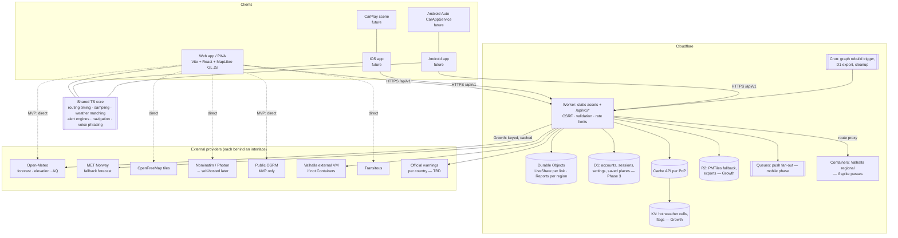

# Target architecture

> ⚠️ **Outdated (docs audit 2026-10-04).** Written before ADR-014/015/016. The target is now: all hosting on
> Cloudflare Workers (not Pages) with R2, D1, Durable Objects, Queues, Cron and Containers; every third-party
> component free forever (own engines and open data); no paid keys, no MET Norway, no public demo servers, and every
> part also runs on localhost. Current target: [ADR-016](decisions/ADR-016-all-on-cloudflare-workers.md),
> [FREE_STACK_PLAN §6/§6a](../FREE_STACK_PLAN.md); plan: [DEVELOPMENT_PLAN](../DEVELOPMENT_PLAN.md). Rewrite: DP-0.7.

Current implementation: [ARCHITECTURE.md](../ARCHITECTURE.md). Requirements:
[PROJECT_REQUIREMENTS.md](../PROJECT_REQUIREMENTS.md). Decisions:
[decisions/](decisions/README.md). Cloudflare facts verified 2026-10-02 against
developers.cloudflare.com (links in [LICENSING_MATRIX](../legal/LICENSING_MATRIX.md)).

## 1. Complete architecture (target, all phases)



Dotted = browser calls the provider directly (MVP, free, per-user limits).
Solid from the Worker = the edge holds the key, caches by grid cell / request,
and protects the provider from fan-out (Growth).

## 2. Cloudflare components — needed when?

| Component | MVP? | Problem it solves | MVP without it? | Trigger to introduce | Status |
| --- | --- | --- | --- | --- | --- |
| **Workers + static assets** | Yes | hosting + API in one deployable | no | — | IMPLEMENTED |
| **Durable Objects (SQLite)** | Yes | live share fan-out; one writer for reports | no (features would go) | — | IMPLEMENTED |
| **Rate limiting binding** | Yes | abuse of writes and the single Reports object | no | — | IMPLEMENTED |
| **Workers Paid ($5/mo min.)** | Beta | Free = 100,000 Worker requests/day | yes, for a private beta | >~50k API requests/day sustained | PLANNED |
| **Custom domain + WAF / zone rate limits** | Beta | L7 protection, managed rules, Cache API certainty | yes | public beta | PLANNED |
| **Turnstile** | No | bots on account creation / email login | yes | accounts ship | PLANNED |
| **D1** | No | accounts, cross-device sync | yes | accounts ship (Phase 3) | PLANNED (schema proposed) |
| **KV** | No | global hot weather cache, flags | yes | weather proxy (commercial) | PLANNED |
| **Cache API** | No | per-PoP response cache | yes | weather/route proxy | PLANNED |
| **R2** | No | self-hosted PMTiles fallback, backups/exports | yes | map fallback / D1 exports | PLANNED |
| **Queues** | No | async fan-out (push notifications, email) | yes | mobile push / email login | FUTURE |
| **Cron Triggers** | No | scheduled rebuilds/exports/cleanup | yes (DO alarms already expire data) | routing graph rebuild; D1 export | PLANNED |
| **Containers** | No | run Valhalla near the edge | yes (public OSRM) | public beta, if spike passes | PLANNED |
| **Workers Logs** | Beta | errors in production | yes, blind | public beta (with URL-free logging) | PLANNED |
| **Workers AI / Vectorize** | No | conversational features | yes | only for P3 AI features | FUTURE |

Free-plan figures used above (verified): Workers 100,000 requests/day and 10 ms
CPU/invocation; Durable Objects 100,000 requests/day, 5M SQLite rows read and
100k written per day; D1 5M rows read / 100k written per day, 500 MB per DB;
KV 100k reads / 1k writes per day; Queues 10,000 operations/day (24 h retention);
R2 10 GB-month, 1M Class A / 10M Class B ops; Workers Logs 200,000 events/day,
3 days retention; Cron Triggers 5 per account.

## 3. MVP → Growth → Scale

### MVP (now → private beta)
```
Browser ──(direct, per-user limits)──▶ OSRM public · Open-Meteo free · Nominatim/Photon · Overpass · Transitous · OpenFreeMap
   └──▶ Worker /api/v1 ─▶ LiveShare DO · Reports DO          (Workers Free)
```
Cost: $0. Limits: provider fair-use terms (Open-Meteo free tier at the app
level: ~30 daily users); the Free Worker request budget lasts to ~950 daily
users today, ~4,000 after the reports corridor fix (COST_AND_SCALE §3).

### Growth (public beta, first commercial step)
- Workers Paid; custom domain; WAF; Workers Logs (URL-free).
- `/api/v1/route` → Valhalla (Containers or VM), regional graph, weekly rebuild.
- `/api/v1/weather/points` → Cache API → KV → Open-Meteo (paid key); MET Norway fallback.
- Precomputed OSM extract for speed limits / cameras / crossings / POIs
  (replaces live Overpass); own Photon/Nominatim or a paid geocoder.
- Reports: one corridor request per refresh; shard DOs by region.
- D1 + accounts (passkeys/email), Turnstile.
- R2 PMTiles fallback style.

### Scale (international, 1M users)
- Planet routing on external compute (graph > Containers' 20 GB disk), Worker in front.
- Weather: Open-Meteo Enterprise or self-hosted model ingestion; precomputed
  weather tiles for the map layer.
- Reports and live share sharded by region; Queues for push fan-out.
- Regional D1 databases only if measured contention requires it.

## 4. Failure and fallback

| Failure | User-visible behaviour (target) | Status |
| --- | --- | --- |
| Weather provider down | last forecasts kept, "stale" label with age; route still works; retry with backoff; Growth: MET Norway fallback | IMPLEMENTED (stale) / PLANNED (fallback) |
| Routing provider down/overloaded | "service busy, try again" (5xx/429 detected); during a drive the loaded route continues; Growth: second router | IMPLEMENTED (message) |
| Geocoder down | coordinates and saved places still work; explicit message | IMPLEMENTED |
| Overpass slow/down | place names/limits absent, labelled "not available"; never blocks the forecast (3.5 s soft deadline) | IMPLEMENTED |
| OpenFreeMap down | map area shows error; route list, weather and voice still work; Growth: PMTiles fallback style | PARTIAL |
| Transitous down / no data | "No public transport found" + Google Maps timetables link (user-initiated) | IMPLEMENTED |
| Worker / DO down | live share and reports show "unavailable"; everything else (client-direct) works | IMPLEMENTED |
| Cloudflare edge outage | app does not load for new visits; installed PWA opens from the shell cache but provider calls depend on network | inherent |
| Offline / tunnel | shell + loaded route + cached forecasts (stale), guidance continues | VERIFIED |

No single external provider can take the whole app down: each is behind an
interface, optional providers fail soft, and the only hard dependencies for
a route are a router and (for its weather) a forecast.

## 5. Observability (target)

| Signal | Tool | Privacy rule |
| --- | --- | --- |
| Uptime | external check on `GET /api/v1/health` (+ static `/`) | none needed |
| Worker errors, latency | Workers Logs (head sampling 0.1–1.0) + Workers metrics | never log request URLs/bodies with coordinates or bbox; log route **names**, status, duration (config option to drop invocation URLs REQUIRES VERIFICATION) |
| Provider failures (client) | aggregated counters via `POST /api/v1/telemetry` (planned) → Workers Analytics Engine | counts by provider + error kind only, no coordinates, no ids |
| Client errors | same beacon, error class + app version + stack hash | no PII, no location |
| Cost | Cloudflare usage dashboards; provider dashboards | — |

## 6. Security boundaries
Browser ↔ Worker: same-origin, CSRF by `Sec-Fetch-Site`, JSON-only writes,
size caps, rate limits. Worker ↔ DOs: internal URLs only. Secrets (paid keys,
email API) only in Worker secrets (`wrangler secret`), never `VITE_*`.
Details: [SECURITY](../security/SECURITY.md).

## 7. Environments
| Environment | Hosting | Data | Providers |
| --- | --- | --- | --- |
| local | `npm run dev` (Vite) + `npm run dev:api` (wrangler dev, local DO/D1) | local only | public providers |
| preview | `wrangler versions upload` per PR (preview URL) | separate DO namespaces via `--env preview` (to configure) | public providers |
| staging | `--env staging`, own D1/KV ids | synthetic | same as production |
| production | `wrangler deploy`, custom domain | real | production providers/keys |

Variables: `VITE_*` are **public** (compiled into the bundle) — never secrets.
Worker secrets via `wrangler secret put` (names prefixed by purpose, e.g.
`OPEN_METEO_API_KEY`). See [DELIVERY](../operations/DELIVERY.md).
