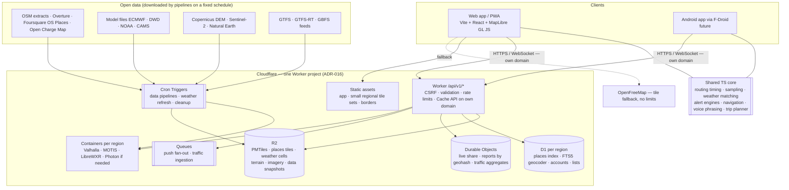

# Target architecture

Current implementation: [ARCHITECTURE.md](../ARCHITECTURE.md). Requirements: [PROJECT_REQUIREMENTS.md](../PROJECT_REQUIREMENTS.md).
Decisions: [ADR-015](decisions/ADR-015-free-software-own-hosting.md) (every third-party component free forever, only
hosting is paid), [ADR-016](decisions/ADR-016-all-on-cloudflare-workers.md) (all hosting on Cloudflare Workers, every
part also runs on localhost). Catalogue of the free components: [FREE_STACK_PLAN](../FREE_STACK_PLAN.md). Work order:
[DEVELOPMENT_PLAN](../DEVELOPMENT_PLAN.md). Cloudflare facts verified 2026-10-04 (links in DEVELOPMENT_PLAN §12).

## 1. Complete architecture

No client ever calls a third-party service with usage limits; the only external call is the OpenFreeMap fallback
(no limits, no paid tier). Pipelines download open data files at a cadence that does not depend on the number of users.

## 2. Components — what problem each solves and when it arrives

| Component | Problem it solves | Arrives (DEVELOPMENT_PLAN) | Status |
| --- | --- | --- | --- |
| Workers + static assets | hosting + API in one deployable; static requests free and unlimited | — | IMPLEMENTED |
| Durable Objects (SQLite) | live share fan-out; reports with one writer per region | sharding: DP-7.2 | IMPLEMENTED (single Reports object) |
| Rate-limiting binding | abuse of writes and listings | all endpoints: DP-3.4 | IMPLEMENTED (writes, listing) |
| Environments `dev` / `preview` / `production` | testing on Workers without touching production; localhost parity | DP-2.2, DP-3.2 | PLANNED |
| R2 | tiles, places tiles, weather cells, terrain, imagery, snapshots (free egress) | stage 4, DP-5.5 | PLANNED |
| D1 (per region) | places index, FTS5 geocoder, accounts | DP-4.2, DP-4.4, DP-7.6 | PLANNED |
| Cron Triggers + Queues | data pipelines, weather refresh, push, traffic ingestion | stage 4, DP-7.5, DP-10.3 | PLANNED |
| Containers (Workers Paid) | Valhalla, MOTIS, LibreWXR (Photon if needed) | stage 5 | PLANNED |
| Workers Paid | Containers; no daily request cap; CPU up to 5 min | DP-5.1 | PLANNED |
| Custom domain | Cache API, WAF and zone rate limits | DP-12.1 | PLANNED |
| Workers Logs, Analytics Engine | errors and counters without coordinates | DP-3.3 | PLANNED |
| Turnstile (free) | bots on account creation and report abuse | DP-7.6 | PLANNED |

Limits that shape the design: Workers — 128 MB memory per isolate; Free 100,000 requests/day and 10 ms CPU, Paid CPU
30 s (up to 5 min); static assets 20,000 files (Free) / 100,000 (Paid), 25 MiB each. Containers — up to 4 vCPU,
12 GiB, 20 GB ephemeral disk per instance; ~1–3 s cold start; account concurrency 1,500 vCPU / 6 TiB. D1 — 10 GB per
database, 50,000 databases. R2 — no egress fees.

## 3. Rollout by region

1. **Local and preview (Workers Free):** app, Worker, Durable Objects, regional data in local/preview D1 and R2.
2. **Georgia (Workers Paid):** engines in Containers with the Georgia graph, feeds and indexes; own tiles; launch.
3. **Caucasus → Turkey/Europe → world:** a new region = data pipeline + engine images + checks (DP-13.9). If the
   capacity pilot (DP-5.6) shows containers cannot hold planet-scale engines, the heavy engines move to rented servers
   behind the same Worker routes (new ADR).

## 4. Failure and fallback

| Failure | User-visible behaviour (target) | Status |
| --- | --- | --- |
| Weather pipeline late / cells missing | last cells kept with a "stale" label and age; route still works | stale handling IMPLEMENTED |
| Routing container down / overloaded | "service busy, try again"; a loaded route keeps guiding; another region instance takes over | message IMPLEMENTED; failover DP-13.5 |
| Geocoder down | coordinates and saved places still work; explicit message | IMPLEMENTED |
| Places API down | place names/limits "not available"; never blocks the forecast | IMPLEMENTED (for Overpass today) |
| Own tiles unavailable | automatic switch to OpenFreeMap | DP-6.8 |
| Transit engine down / no data | "No public transport found" | IMPLEMENTED |
| Durable Objects down | live share and reports "unavailable"; everything else works | IMPLEMENTED |
| Cloudflare edge outage | app does not load for new visits; installed PWA opens from the shell cache | inherent |
| Offline / tunnel | shell + loaded route + cached forecasts (stale), guidance continues | VERIFIED |

## 5. Observability

| Signal | Tool | Privacy rule |
| --- | --- | --- |
| Uptime | GitHub Actions cron on `GET /api/v1/health` + static `/` | none needed |
| Worker and engine errors, latency | Workers Logs (sampling) + metrics | never log URLs/bodies with coordinates or bbox; log route names, status, duration |
| Engine and pipeline failure rates | Analytics Engine counters | counts by component + error kind only |
| Client errors | `POST /api/v1/telemetry` (planned) | no PII, no location |
| Hosting cost | Cloudflare usage, monthly report (DP-12.7) | — |

## 6. Security boundaries

Browser ↔ Worker: same-origin, CSRF by `Sec-Fetch-Site`, JSON-only writes, size caps, rate limits. Worker ↔ Durable
Objects and Containers: internal bindings only; containers are not reachable directly from the internet. Secrets (VAPID
keys, admin credentials) only as Worker secrets (`wrangler secret`), never `VITE_*`. Details:
[SECURITY](../security/SECURITY.md).

## 7. Environments

| Environment | Hosting | Data | Engines |
| --- | --- | --- | --- |
| local | `npm run dev` (Vite + Cloudflare Vite plugin; local DO/D1/R2) | seeded region | the same images in Docker |
| preview | `wrangler deploy --env preview` on `*.workers.dev` | own DO/D1/R2 | Containers (from stage 5) |
| production | `wrangler deploy --env production`, own domain | real | Containers per region |

`VITE_*` values are **public** (compiled into the bundle). See [DELIVERY](../operations/DELIVERY.md) and
[DEVELOPMENT_PLAN §2](../DEVELOPMENT_PLAN.md).
