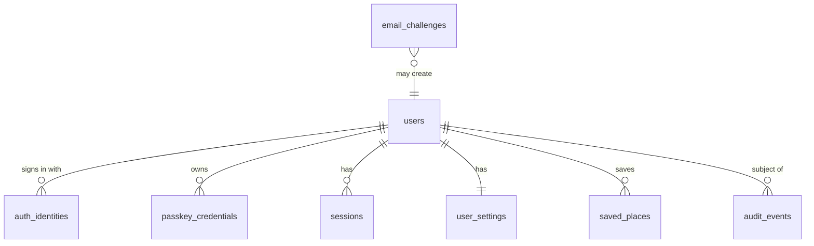

# Data model

> **Update 2026-10-04 ([ADR-016](../architecture/decisions/ADR-016-all-on-cloudflare-workers.md)):** D1 is planned not only
> for accounts but also for regional places and the FTS5 geocoder index (one database per region/country, ≤10 GB
> each — REQ-CF-015, DP-4.2/DP-4.4); places tiles, weather cells and map tiles live in R2.

## Files in R2 (in use)

| Bucket / prefix | Content | Written by | Read by |
| --- | --- | --- | --- |
| `navweather-weather` `weather/latest.json` | index of the current build (`WeatherIndex`, `src/api/weather.ts`): run, model runs, steps (unix s), per-variable interval/presence, scales, tiles present | `pipelines/weather/build.mjs` (last, so a build appears whole) | Worker, cached 60 s per isolate |
| `weather/runs/<run>/t/<ty>/<tx>.bin` | one 5° × 5° tile of the 0.25° grid (land and coasts, 1 030 tiles): 400 points × [height, 11 variables × ~85 steps] int16 (−32768 = no value) — ~1.6 KB per point at a fixed offset (range reads) | the pipeline (twice a day with new model runs; the two newest builds are kept) | `/api/v1/weather/forecast` (+ edge cache per point) |

No personal data: model fields per grid cell. Locally the same bucket lives in `.wrangler/state` (`npm run data:weather`).

Decision: [ADR-007](../architecture/decisions/ADR-007-data-storage.md).
**Status: D1 is not in use.** The schema below is PROPOSED for Phase 3
(optional accounts); the SQL lives in
[`database/migrations/0001_accounts.sql`](../../database/migrations/0001_accounts.sql)
and is **not applied** (no D1 binding in `wrangler.toml`).

## 0. Open data we build

| Data | Where | Built by |
| --- | --- | --- |
| Country borders (Natural Earth, public domain) | `src/trip/data/countries-v1.json` (in the app and the Worker bundle) | `npm run data:borders` |
| Places, cameras, crossings, speed limits per layer and tile (OSM, ODbL) | static assets `/data/places/v1/…` (not in git) | `npm run seed:local` (download + `data:osm`) |
| Geocoder index (OSM, ODbL): `geo` (id, kind, rank, lat, lon, name, name_en, name_ru, ctx_en, ctx_ru) + FTS5 `geo_fts(names, ctx)` (unicode61, prefixes 2–4) + `geo_meta` | D1 `navweather-geo` (binding `GEO`) | `npm run data:osm` → `data/build/ge/geocode.sql` → `npm run db:geo:local` |

## 1. What lives where today

| Data | Where | Retention |
| --- | --- | --- |
| Settings, saved places, recents, parking spot | browser localStorage | until the user clears it (recents can be off) |
| Resumable drive (destination + stops only) | tab sessionStorage | 30 min, cleared on stop/arrival |
| Live share: latest position, trip, route once, key hash | Durable Object per share (SQLite) | deleted on stop or expiry (15 min – 24 h) |
| Driver reports + votes (reporter as daily-salted hash) | one Durable Object (SQLite) | expired rows removed hourly (45 min – 12 h, max 3× when confirmed) |
| Positions, routes, trip history | **nowhere** | — |

## 2. Proposed D1 schema (Phase 3)

| Table | Why it is justified | Not stored |
| --- | --- | --- |
| `users` | the account row; deletion target | names beyond an optional display name; no phone, no birthdate |
| `auth_identities` | one user, several sign-in methods (email, passkey, later Apple/Google) | provider tokens |
| `passkey_credentials` | WebAuthn public keys and counters | private keys (never leave the device) |
| `email_challenges` | single-use, short-lived login codes (needs strong consistency → not KV) | the code itself (hash only) |
| `sessions` | revocable sessions, mobile refresh-token rotation | raw tokens (hash only), IP addresses |
| `user_settings` | synced preferences as one versioned JSON document | anything location-derived |
| `saved_places` | synced Home/Work/favourites (user-created, user-deletable) | visit history, timestamps of visits |
| `audit_events` | security events (sign-in, new passkey, deletion) for abuse handling | IPs, coordinates; 90-day retention |

**Rejected tables** (not justified now): `routes`, `route_points`,
`saved_routes` (no server-side trips; REQ-PRIV-001), `weather_cache`,
`weather_forecasts` (weather cells are files in R2, ADR-007), `weather_alerts` (computed on
device), `notifications`, `devices` (until mobile push), `subscriptions` (until
monetisation), `api_keys` (until a public API), `reports` (Durable Objects).

## 3. Retention

| Data | Retention |
| --- | --- |
| Account, settings, saved places | until the user deletes them or the account |
| Sessions | expiry (web 30 days sliding; mobile refresh 90 days), deleted on logout/revoke; daily cleanup |
| Email challenges | 15 min; deleted on use; daily cleanup |
| Audit events | 90 days |
| Deleted account | rows hard-deleted immediately (FK cascade); one audit event with a salted hash of the user id |

Cleanup runs from a Cron Trigger (daily, UTC) — the first justified cron.

## 4. What must not go into D1
Weather responses, tiles, geocoding results (caches); positions and routes
(privacy); live-share state and reports (real-time, Durable Objects);
anything needing writes faster than one database can serialise.

## 5. Migration rules
Forward-only numbered files (`0002_…sql`); every migration backward compatible
with the previously deployed Worker (add columns nullable, backfill, then
switch code, then drop in a later migration). CI applies migrations to
preview/staging before deploy; production via `wrangler d1 migrations apply`
in the deploy workflow. Time Travel (7 days Free / 30 days Paid) is the
point-in-time restore; a weekly export to R2 is the long-term backup.
